# Web3 Wallet 可视化 E2E 测试功能截图画廊

本文档收录由 Playwright 自动化端到端测试套件（`tests/e2e/visual-walkthrough.spec.ts`）在移动端标准视口（412x915）下渲染并截取的完整产品功能图集。涵盖了从初次建钱包、助记词备份校验、资产主页、代币转账、添加代币、交易记录、网络管理到多账户与安全锁屏的全套核心功能流。

---

## 📸 功能流程图集目录

- [1. 初始引导与开户流程](#1-初始引导与开户流程)
  - [01. 欢迎落地页](#01-欢迎落地页)
  - [02. 创建钱包表单](#02-创建钱包表单)
  - [03. 创建钱包校验提示](#03-创建钱包校验提示)
  - [04. 助记词离线备份保护](#04-助记词离线备份保护)
  - [05. 助记词解锁展示与备份确认](#05-助记词解锁展示与备份确认)
- [2. 资产总览与代币管理](#2-资产总览与代币管理)
  - [06. 钱包资产主页](#06-钱包资产主页)
  - [07. 链上收款页面](#07-链上收款页面)
  - [08. 发送原生币页面](#08-发送原生币页面)
  - [09. 发送确认摘要](#09-发送确认摘要)
  - [10. 添加自定义 ERC20 代币](#10-添加自定义-erc20-代币)
  - [11. 包含自选代币的主页资产列表](#11-包含自选代币的主页资产列表)
  - [12. 原生币 (ETH) 资产详情页](#12-原生币-eth-资产详情页)
  - [13. 自定义代币 (MUSD) 资产详情页](#13-自定义代币-musd-资产详情页)
- [3. 活动记录与网络管理](#3-活动记录与网络管理)
  - [14. 交易活动历史记录](#14-交易活动历史记录)
  - [15. 交易确认详情页](#15-交易确认详情页)
  - [16. 多链网络管理中心](#16-多链网络管理中心)
  - [17. 添加自定义 EVM 网络](#17-添加自定义-evm-网络)
- [4. 账户中心、地址簿与安全](#4-账户中心地址簿与安全)
  - [18. 多账号管理与 HD 派生](#18-多账号管理与-hd-派生)
  - [19. 常用收款人地址簿](#19-常用收款人地址簿)
  - [20. 设置中心](#20-设置中心)
  - [21. 钱包安全锁屏与解锁](#21-钱包安全锁屏与解锁)
  - [22. 助记词/私钥导入钱包页](#22-助记词私钥导入钱包页)

---

## 1. 初始引导与开户流程

### 01. 欢迎落地页
- **文件**: `01-welcome-page.png`
- **功能说明**: 采用纯粹极简的高端深色玻璃态（Glassmorphism）与渐变质感，去除技术性运行环境卡片，聚焦呈现品牌 Logo、标语及创建/导入钱包两大核心入口。

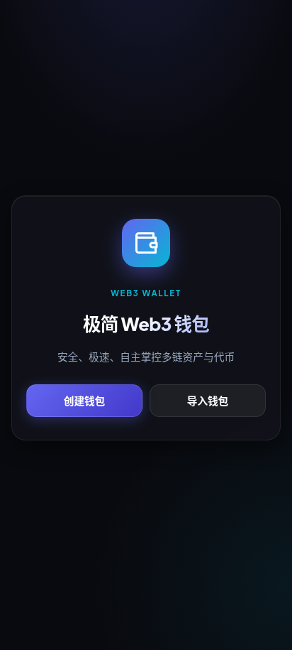

---

### 02. 创建钱包表单
- **文件**: `02-create-wallet.png`
- **功能说明**: 设置新钱包别名、不少于 8 位的解锁密码、重复输入确认密码，支持一键切换生物识别快捷解锁。

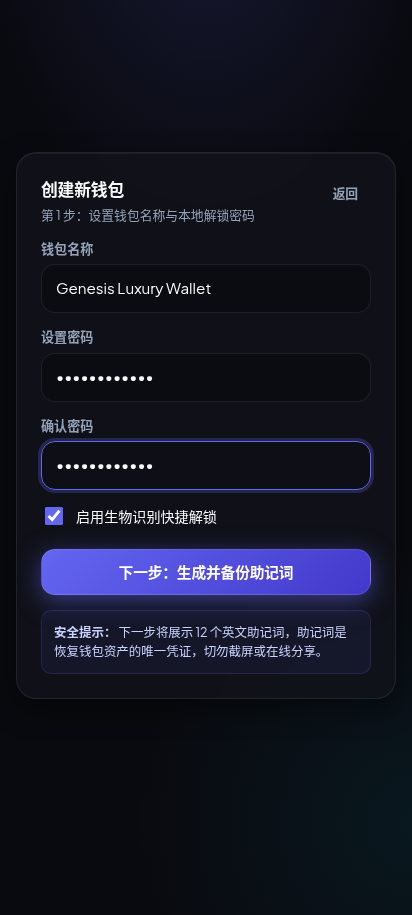

---

### 03. 创建钱包校验提示
- **文件**: `03-create-wallet-validation.png`
- **功能说明**: 提交前对表单项进行本地实时前置校验，针对两次密码不一致或长度不足给出醒目的红色高亮报错。

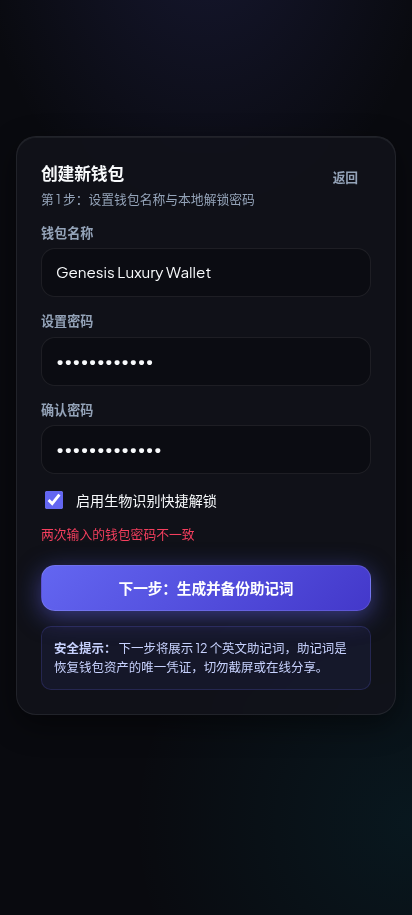

---

### 04. 助记词离线备份保护
- **文件**: `04-backup-phrase-locked.png`
- **功能说明**: 助记词生成后默认加密锁定，用户必须输入创建时设定的钱包密码并阅读防截屏/防网络泄露安全警示，方可解密显示。

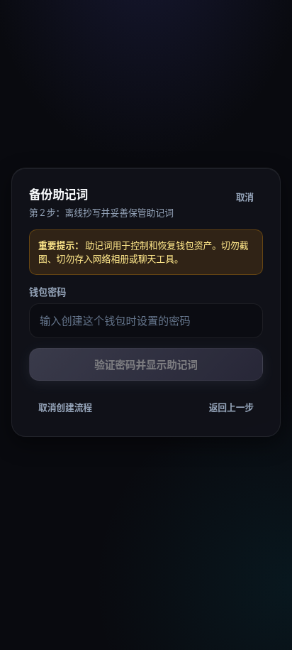

---

### 05. 助记词解锁展示与备份确认
- **文件**: `05-backup-phrase-revealed.png`
- **功能说明**: 12 个 BIP-39 英文助记词通过毛玻璃卡片清晰按序呈现；支持"一键复制助记词"（标准空格分隔格式，可直接粘贴导入），并带有实时复制状态反馈；强制勾选离线备份确认复选框后激活进入钱包主流程。

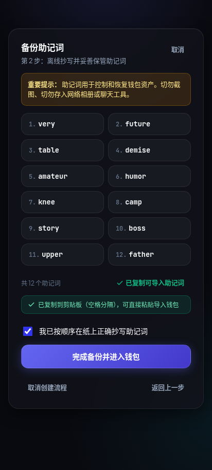

---

## 2. 资产总览与代币管理

### 06. 钱包资产主页
- **文件**: `06-wallet-home.png`
- **功能说明**: 账户缩写徽标、主资产卡片、实时块高与余额展示（1.5 ETH）、核心操作快捷栏统一凝练为双字排版（【发送】、【收款】、【扫码】、【刷新】），并清理了资产列表头重复的扫码入口。

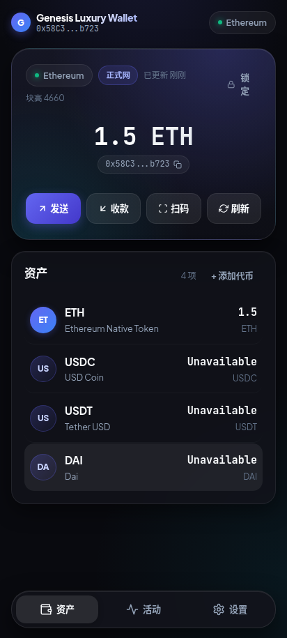

---

### 07. 链上收款页面
- **文件**: `07-receive-page.png`
- **功能说明**: 自动生成标准的 EIP-681 EVM 收款二维码与完整 0x 地址，支持一键复制到剪贴板及外链区块浏览器核验。

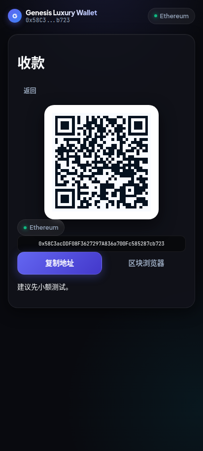

---

### 08. 发送原生币页面
- **文件**: `08-send-page-native.png`
- **功能说明**: 支持多币种选择、收款地址录入、Max 全部余额快捷填充、以及基于当前网络 Gas Price 的实时矿工费预估。

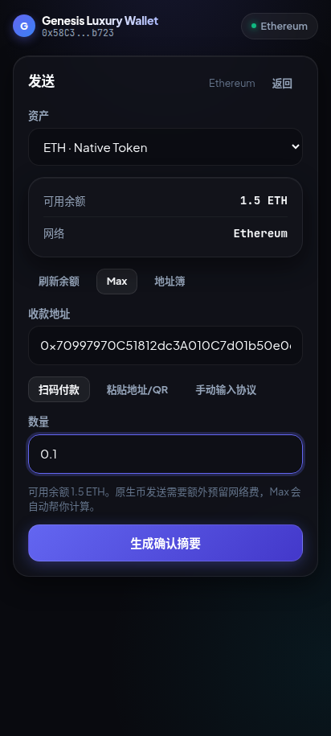

---

### 09. 发送确认摘要
- **文件**: `09-send-confirmation.png`
- **功能说明**: 完整展开交易摘要卡片：包含发送资产、网络、Chain ID、Nonce、接收方、转账数量、Gas Limit、Max Fee / Priority Fee 与预估网络费，保障用户签名透明度。

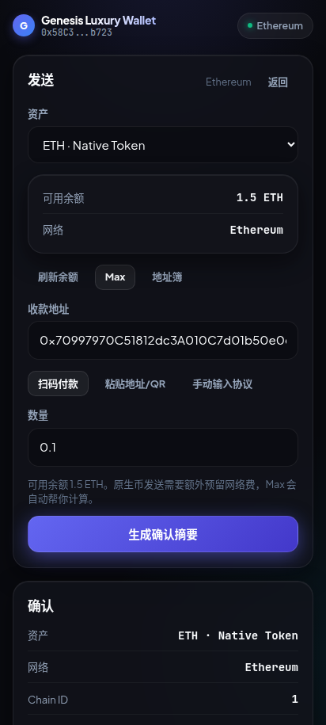

---

### 10. 添加自定义 ERC20 代币
- **文件**: `10-add-token.png`
- **功能说明**: 输入任意合规的 ERC20 合约地址后，系统自动通过 RPC 读取链上元数据，动态回填代币名称（Mock USD）、符号（MUSD）及精度（6）。

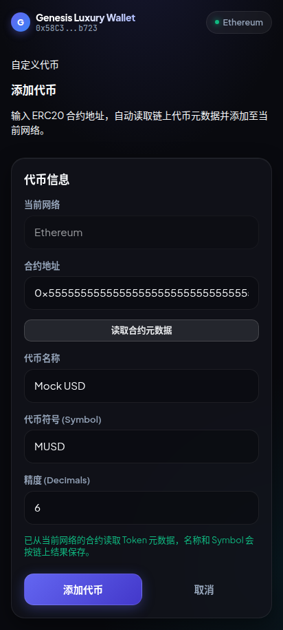

---

### 11. 包含自选代币的主页资产列表
- **文件**: `11-wallet-home-with-token.png`
- **功能说明**: 添加后的自定义代币即时更新并持久化至账户列表，主页同时展示原生币 ETH 与自选代币 MUSD。

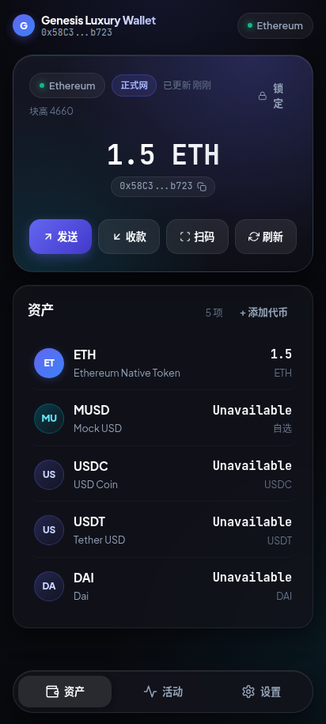

---

### 12. 原生币 (ETH) 资产详情页
- **文件**: `12-token-detail-native.png`
- **功能说明**: 原生资产独立看板，展现代币网络标签、当前账户余额、快捷发送与收款入口。

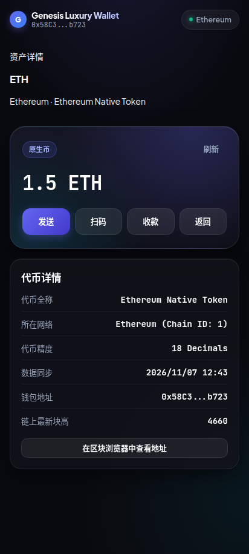

---

### 13. 自定义代币 (MUSD) 资产详情页
- **文件**: `13-token-detail-erc20.png`
- **功能说明**: ERC20 代币专属页面，标注代币类型、精确到最小精度的数额展示，支持在不影响链上资产的前提下从本地列表移除。

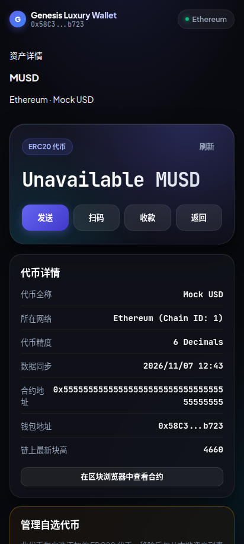

---

## 3. 活动记录与网络管理

### 14. 交易活动历史记录
- **文件**: `14-activity-page.png`
- **功能说明**: 当前账户作用域的完整交易流，展示转账类型、涉及币种、数量、相对时间（刚刚/几分钟前）以及已完成/进行中的彩色状态胶囊。

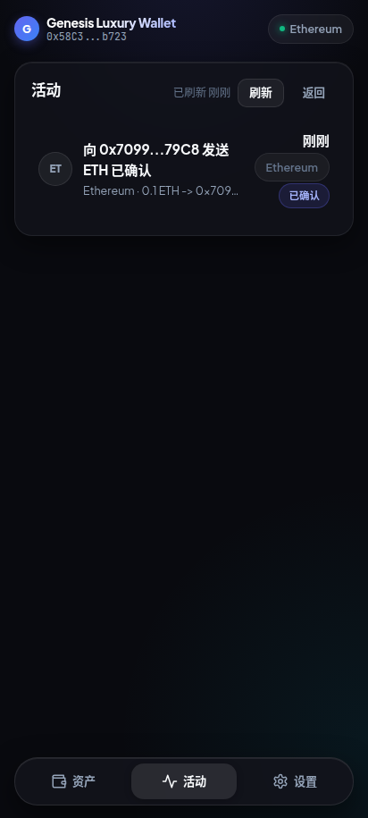

---

### 15. 交易确认详情页
- **文件**: `15-transaction-detail.png`
- **功能说明**: 深度解析链上 Receipt 与 Block 详情：交易哈希（TxHash）、区块高度、发送方、接收方、消耗 Gas 与实际网络费用。

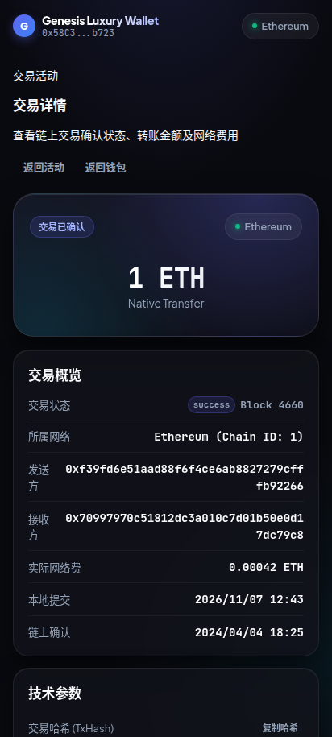

---

### 16. 多链网络管理中心
- **文件**: `16-networks-page.png`
- **功能说明**: 顶部核心指标看板（生效网络、全网数量、RPC 状态），清晰区分“正式网”与“测试网”，支持一键无感切换。

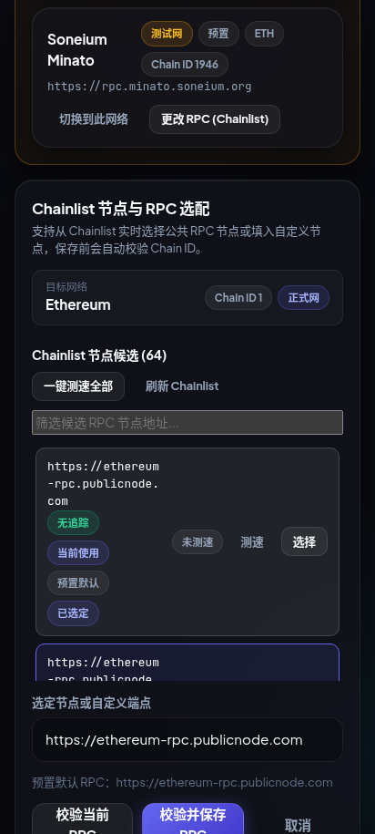

---

### 17. 添加自定义 EVM 网络
- **文件**: `17-add-custom-network.png`
- **功能说明**: 支持配置任意兼容 EVM 的二层或侧链网络（网络名称、Chain ID、RPC URL、原生币符号），内置 Chain ID 连通性预校验机制。

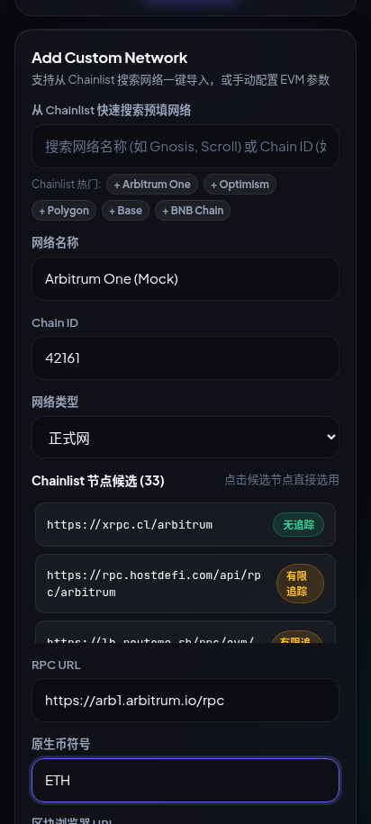

---

## 4. 账户中心、地址簿与安全

### 18. 多账号管理与 HD 派生
- **文件**: `18-accounts-page.png`
- **功能说明**: 经 UI 深度排版优化，剔除繁冗调试指标大卡片，采用轻量化激活账户看板与现代化账户卡片流；支持一键复制完整地址、派生新地址、重命名与安全删除账户。


---

### 19. 常用收款人地址簿
- **文件**: `19-address-book.png`
- **功能说明**: 本地地址簿模块，允许用户记录经常转账的联系人别名、EVM 地址与专属备注，在转账时自动完成反向解析。

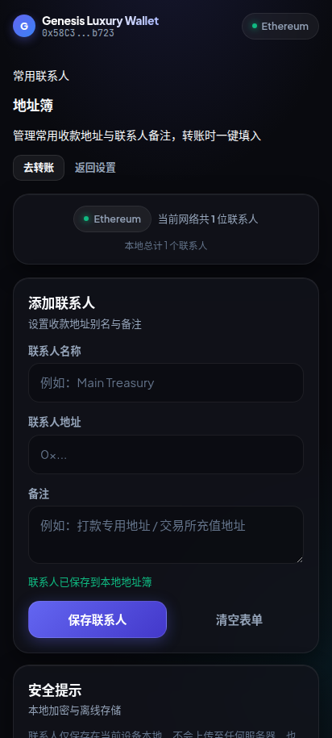

---

### 20. 设置中心
- **文件**: `20-settings-page.png`
- **功能说明**: 钱包参数聚合页面，展示当前活跃地址、网络、备份状态；提供"安全与解锁"管理中心（生物识别硬件状态与开关、3x3 手势连线密码设置与修改）及一键锁屏。

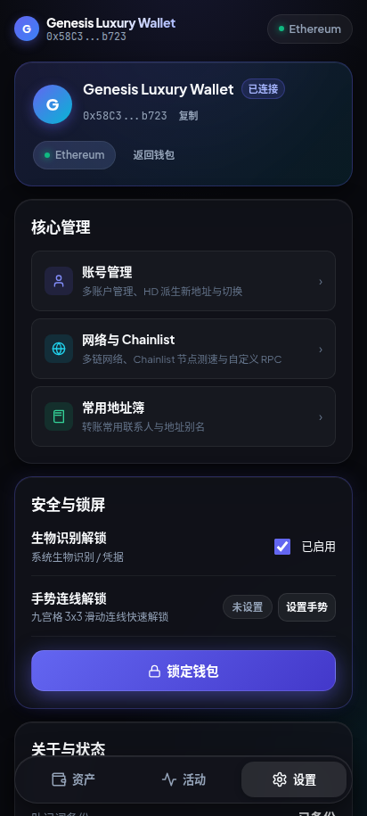

---

### 21. 钱包安全锁屏与解锁
- **文件**: `21-lock-unlock-page.png`
- **功能说明**: 多模式安全锁屏保护，支持多种解锁方式自主选择：【生物识别一键解锁】（支持设备指纹/面容）、【标准密码解锁】与【3x3 手势连线快速解锁】；并支持多账号快速切换。

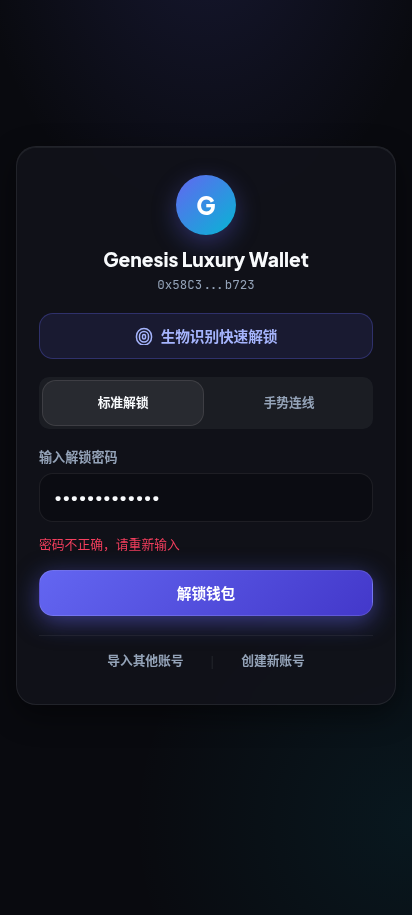

---

### 22. 助记词/私钥导入钱包页
- **文件**: `22-import-wallet-page.png`
- **功能说明**: 支持通过 12 词助记词或 64 位标准 EVM 私钥导入已有资产，带有分段选项卡切换与格式前置核验。

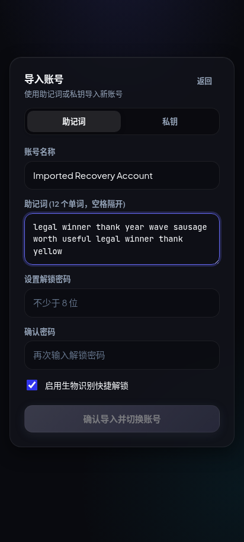

---

## 🛠️ 如何重新生成最新截图

在项目根目录下执行以下命令即可全自动运行可视化 E2E 测试并更新所有截图：

```bash
pnpm exec playwright test tests/e2e/visual-walkthrough.spec.ts
```
